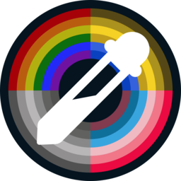
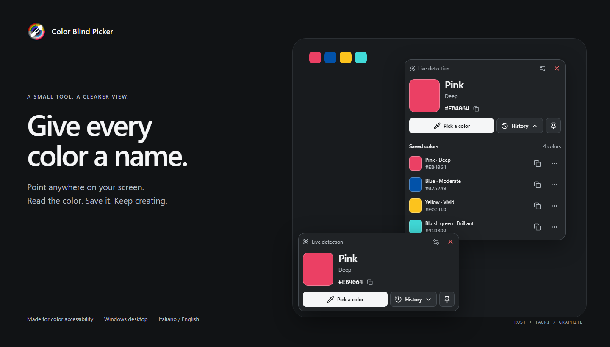
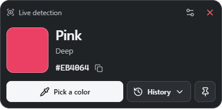
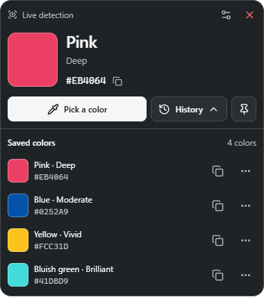
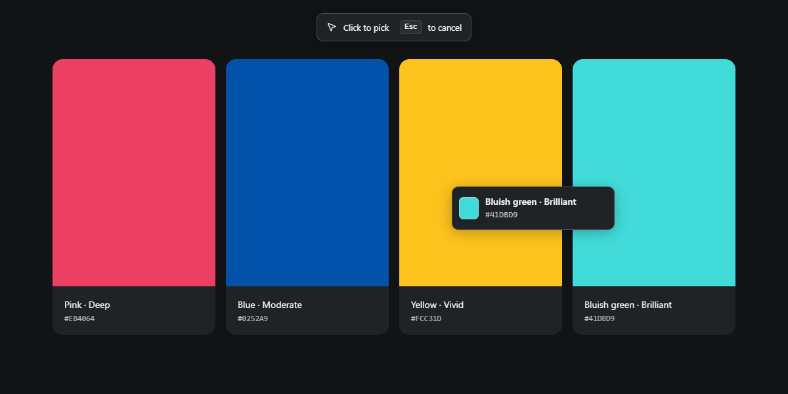
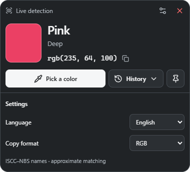
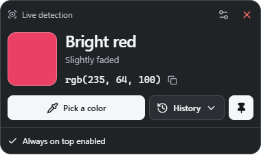
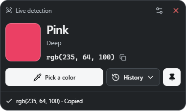
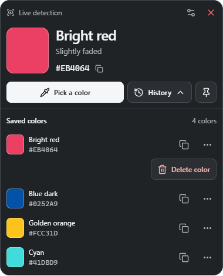
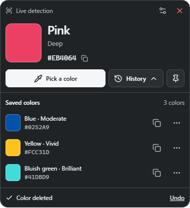

<p align="center">
  
</p>

<h1 align="center">Color Blind Picker</h1>

<p align="center">
  <strong>Give every color a name.</strong><br>
  A small floating Windows app that identifies screen colors in words.
</p>

<p align="center">
  
</p>

<p align="center">
  <a href="#why-color-blind-picker">Why it exists</a> ·
  <a href="#screenshots">Screenshots</a> ·
  <a href="#get-started">Get started</a> ·
  <a href="docs/DEVELOPMENT.md">Development</a>
</p>

<p align="center">
  
</p>

## Why Color Blind Picker?

A HEX code tells you a value. Sometimes you need the **name of the color**.

Color Blind Picker was originally built in WPF for a friend with color blindness. The new Rust edition keeps that simple purpose: move the pointer over anything on screen and get a readable description, a color sample and a value you can copy.

It stays small, can remain above other windows and keeps saved colors close at hand, whether you're choosing a palette, checking an interface or identifying something on your desktop.

| Identify | Capture | Keep |
| --- | --- | --- |
| Read the color under your pointer in real time. | Pick a pixel and copy its HEX or RGB value. | Save colors to history and revisit them later. |

## Screenshots

The screenshots below come from the Windows app using an isolated example palette. The interface is available in **English and Italian**.

### Live identification

A color name, a plain-language qualifier and a copyable value. Move the pointer outside the picker to identify another color.

<p align="center">
  
</p>

### Saved color history

Keep the colors you pick, see their names and copy a value again. History expands only when you need it.

<p align="center">
  
</p>

### Pick anywhere on your screen

Click **Pick a color** and the main window steps aside. A transparent capture surface lets you choose a pixel without activating the application underneath. The tooltip follows the pointer; **Esc** cancels and brings the picker back.

<p align="center">
  
</p>

*Capture overlay shown over an example palette for documentation.*

### Your language, your format

Choose English or Italian and switch the copy format between HEX and RGB. The app remembers your settings.

<p align="center">
  
</p>

### Always within reach

Pin the picker above other windows, then drag its title bar wherever it is most useful.

<p align="center">
  
</p>

<details>
  <summary><strong>A closer look: copying, color actions and undo</strong></summary>
  <br>
  <p>Explicit feedback confirms each action. Saved colors can be deleted from their row menu, with a short window to undo the deletion.</p>
  <h4>Copy HEX or RGB</h4>
  <p align="center">
    
  </p>
  <h4>Color actions</h4>
  <p align="center">
    
  </p>
  <h4>Delete, then undo</h4>
  <p align="center">
    
  </p>
</details>

## Designed for clarity

- **Words alongside color.** Every live or saved sample has a descriptive name; recognition does not depend on the swatch alone.
- **A quiet interface.** Neutral Graphite surfaces keep attention on the sampled color.
- **Clear controls.** Labeled primary actions, tooltips, keyboard focus and a visible pressed state for the pin button.
- **Useful feedback.** Copy, save and delete actions have explicit confirmations. Deletion can be undone for up to 10 seconds.
- **Less screen-reader noise.** Explicit action results are announced; continuous pointer changes are not repeatedly announced.
- **Local history.** The latest 1,000 saved colors and your preferences persist between sessions. Identification and history work locally, without an account or a server.

Screen sampling currently supports **Windows** and virtual-desktop coordinates for multiple monitors. It reads 8-bit desktop RGB, interpreted as SDR sRGB for naming; it is not a color-calibration or HDR tool.

## Color names with a documented reference

Color descriptions now use the historical **ISCC–NBS nomenclature**, replacing the original HSL hue checkpoints. The app compares a sample with published reference centroids in CIELAB using **CIEDE2000**, then shows the selected hue and qualifier in English or Italian. For example, `#964B00` is **Brown · Strong** and `#FFC0CB` is **Pink · Light**.

Matching is **approximate**: the reference publication defines named regions, and choosing the nearest central sample does not reproduce their exact boundaries. The source includes 267 categories; this version uses **266 numerical references**, excluding one ambiguous printed notation. Italian terms are project translations. The original English designation and ID are available by hovering over the main name or a history label.

Names can differ from CSS keywords or familiar everyday descriptions. Exact HEX/RGB values are preserved, and a short delay stabilizes ambiguous live labels without delaying the swatch, value, copying or capture. Saved history keeps its original values and receives the new descriptions automatically.

The [naming guide](docs/COLOR-NAMING.md) documents the standards choice, source data, conversion, exclusions, before/after examples, tests and reproducible generation. The [research note](docs/COLOR-NAMING-RESEARCH.md) compares ISCC–NBS, CSS, ISO/CIE and professional catalogs.

## Get started

### Download for Windows

**[Download Color Blind Picker 2.0.0](https://github.com/M3GA17/Color-Blind-Picker/releases/tag/v2.0.0)** — the new Rust / Tauri edition.

| Package | Download |
| --- | --- |
| Windows x64 installer | [Install Color Blind Picker](https://github.com/M3GA17/Color-Blind-Picker/releases/download/v2.0.0/Color-Blind-Picker_2.0.0_windows-x64-setup.exe) |
| Windows x64 portable archive | [Download the ZIP](https://github.com/M3GA17/Color-Blind-Picker/releases/download/v2.0.0/Color-Blind-Picker_2.0.0_windows-x64_portable.zip) |
| SHA-256 checksums | [SHA256SUMS.txt](https://github.com/M3GA17/Color-Blind-Picker/releases/download/v2.0.0/SHA256SUMS.txt) |

The portable version requires Microsoft Edge WebView2. Extract the whole archive before running the app. The installer downloads WebView2 if it is missing, which requires an internet connection. Both packages keep settings and history in your user profile. [Release notes](docs/releases/v2.0.0.md) cover the rewrite, new color names and migration. The previous [v1.1.0 release](https://github.com/M3GA17/Color-Blind-Picker/releases/tag/v1.1.0) remains available for the WPF application.

### Run the desktop app

You need **Windows**, **Node.js 24**, **Rust stable with the MSVC toolchain**, Microsoft C++ Build Tools and WebView2. Follow the [Tauri Windows prerequisites](https://v2.tauri.app/start/prerequisites/) if those native tools are not installed.

```sh
git clone https://github.com/M3GA17/Color-Blind-Picker.git
cd Color-Blind-Picker
npm ci
npm run desktop
```

### Create an installer

```sh
npm run bundle
```

The build produces:

| File | Location |
| --- | --- |
| Windows executable | `src-tauri/target/release/color-blind-picker.exe` |
| Windows installer | `src-tauri/target/release/bundle/nsis/` |

For a browser-only layout preview, use `npm run dev`. Screen sampling and other native actions require the desktop app.

## Everyday controls

| Control | What it does |
| --- | --- |
| **Move the pointer** | Identify a color outside the picker window. The current value stays unchanged while you interact with the picker. |
| **Pick a color** | Choose a screen pixel, save it to history and copy it in the selected format. |
| **Esc during capture** | Cancel without saving a color. |
| **Click the current value** | Copy the current HEX or RGB value. |
| **History** | Expand or collapse saved colors. |
| **Copy in a history row** | Copy a saved color in the selected format. |
| **More actions → Delete color** | Remove a saved entry; use **Undo** to restore it. |
| **Pin** | Toggle always-on-top behavior. |
| **Settings** | Change the language and copy format. |
| **Drag the title bar / red X** | Move or close the window. |

## Saved data & WPF migration

Your settings and color history are stored locally at:

```text
%APPDATA%\io.github.m3ga17.colorblindpicker\state.json
```

Writes use a temporary file and atomic replacement. Launching the app again focuses the existing instance, keeping one owner of the history file.

**Coming from the WPF version?** Before the first launch, place its `colorList.txt` beside the new executable or in the working directory. The app imports that JSON array, keeps the original file and displays the newest colors first. Existing new-format data takes precedence. Invalid saved data is preserved rather than silently overwritten.

## Under the hood

| Layer | Built with | Role |
| --- | --- | --- |
| Native core | **Rust** | Color descriptions, Windows screen access, clipboard and persistent data |
| Desktop shell | **Tauri 2** | Floating window, capture overlay and single-instance behavior |
| Interface | **React + TypeScript** | Readout, history, settings and action feedback |
| Frontend tooling | **Vite + Lucide** | Development build and interface icons |

The [Graphite design board](design/graphite-design-system.svg) and [design tokens](design/graphite.tokens.json) are included in the repository. The original C# / XAML implementation remains in Git history.

## Development & contributions

The [development guide](docs/DEVELOPMENT.md) covers setup, packaging, architecture, automated checks, the native Windows smoke test and regenerating these screenshots. Releases are built locally and published manually; the [release guide](docs/RELEASING.md) documents the process without GitHub Actions.

Found a bug, an awkward color description or an accessibility issue? [Open an issue](https://github.com/M3GA17/Color-Blind-Picker/issues) with the steps to reproduce it. For color descriptions, include the HEX value and the selected language; for desktop issues, include your Windows version.

---

<p align="center">
  Built for a friend. Rebuilt to keep color identification simple.
</p>
